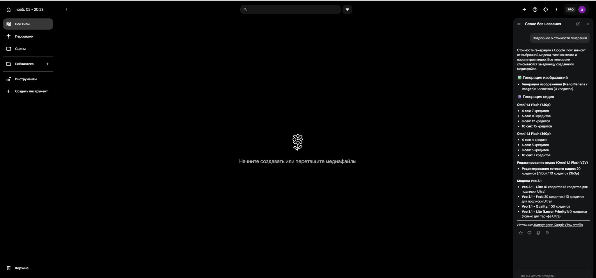

<div align="center">
  
  <h1>Flow Helper RU</h1>
  <p><strong>Экспериментальное расширение Chrome для Google Flow</strong></p>
  <p>
    
    
    
    
  </p>
</div>

**Flow Helper RU** — неофициальное экспериментальное расширение для Google Chrome. Оно локально в браузере обрабатывает определённый RPC-ответ Google Flow, связанный с региональным флагом интерфейса, и предоставляет переключатель включения/отключения.

> **Важно:** расширение не меняет страну Google-аккаунта, платёжный профиль, подписку, возрастные или иные серверные права. Оно не предоставляет VPN и не гарантирует доступ к генерации. Google может менять внутренний протокол в любое время.

## Возможности

- Включение и отключение обработки одним нажатием.
- Обработка только на `https://flow.google.com/`.
- Локальная работа без собственного сервера и удалённого кода.
- Не запрашивает пароль и не отправляет данные на сторонние серверы.
- Открытие Google Flow из окна расширения.

## Как это работает

Расширение использует Manifest V3 и регистрирует локальный скрипт в `MAIN` world на страницах Google Flow. Скрипт отслеживает запрос к внутреннему `batchexecute` endpoint и при совпадении RPC ID `cPZSdc` пытается изменить соответствующее поле в ответе.

Это вмешательство во внутренний, недокументированный протокол Google Flow. Структура ответа и индекс поля могут измениться без предупреждения. Если структура не соответствует ожидаемой, обработчик старается оставить исходный ответ без изменений.

## Требования

- Google Chrome с поддержкой Manifest V3 и `chrome.scripting`.
- Доступ к `flow.google.com`.
- VPN/прокси может понадобиться для сетевого доступа из региона, где сервис недоступен. Само расширение VPN не заменяет.

## Установка из исходников

1. Скачайте ZIP-архив репозитория и распакуйте его **в постоянную папку** либо клонируйте репозиторий.
2. Откройте `chrome://extensions/`.
3. Включите **Режим разработчика**.
4. Нажмите **Загрузить распакованное расширение**.
5. Выберите корневую папку проекта — ту, где находится `manifest.json`.
6. Закрепите Flow Helper RU на панели Chrome.
7. Откройте Google Flow. При необходимости включите расширение и обновите вкладку.

## Использование

1. Откройте Google Flow.
2. Нажмите значок Flow Helper RU.
3. Нажмите **Включить** или **Выключить**.
4. При изменении состояния открытые вкладки Google Flow перезагружаются, чтобы применить новое состояние скрипта.

## Структура проекта

```text
Flow-Helper-RU/
├── manifest.json       # Manifest V3
├── background.js       # Service worker и переключатель состояния
├── hook.js             # Локальный обработчик RPC-ответа
├── popup.html          # Окно расширения
├── popup.css           # Стили окна расширения
├── popup.js            # Логика интерфейса
├── docs/
│   └── images/         # Баннер и иллюстрации README
├── LICENSE
├── NOTICE.md
├── CHANGELOG.md
└── SECURITY.md
```

## Конфиденциальность и безопасность

- В манифесте запрошены разрешения `scripting`, `storage` и `tabs`.
- Доступ к сайтам ограничен `https://flow.google.com/*`.
- Состояние переключателя хранится в `chrome.storage.local`.
- В проекте нет собственного backend-сервера, аналитики или загрузки удалённого JavaScript.
- Скрипт работает с внутренним ответом Google Flow. Перед использованием изучите исходный код и устанавливайте расширение только из доверенного источника.

Подробности: [SECURITY.md](SECURITY.md) и [NOTICE.md](NOTICE.md).

## Ограничения и устранение неполадок

- **Flow по-прежнему сообщает о неподдерживаемом регионе.** Обновите вкладку, проверьте подключение и регион VPN. Это расширение не может отменить все серверные проверки Google.
- **Интерфейс открылся, но генерация недоступна.** Возможны отдельные ограничения аккаунта, подписки, платёжного профиля, модели или региона.
- **После обновления Flow расширение перестало помогать.** Google мог изменить RPC endpoint, RPC ID или формат ответа. Создайте Issue с описанием ошибки и, если возможно, обезличенным скриншотом. Не публикуйте cookies, токены, HAR-файлы или личные данные.
- **Переключатель не срабатывает.** Откройте `chrome://extensions/`, проверьте ошибки расширения и перезагрузите его.

## Скриншот

Ниже — интерфейс Google Flow из тестовой сессии. Это скриншот самого сервиса, а не окна расширения.



## Участие в разработке

Сообщения об ошибках и предложения приветствуются. Перед отправкой Issue проверьте, что в нём нет личных данных, cookies, токенов или содержимого приватных запросов. См. [CONTRIBUTING.md](CONTRIBUTING.md).

## Отказ от ответственности

Flow Helper RU — независимый проект, не являющийся продуктом Google и не одобренный Google LLC. Google Flow и Google являются товарными знаками их соответствующих владельцев. Используйте проект на свой риск и соблюдайте условия использования Google.

## Лицензия

Код проекта распространяется по лицензии [MIT](LICENSE), если иное не указано в соответствующем файле. Сведения о происхождении и сторонних проектах приведены в [NOTICE.md](NOTICE.md).
